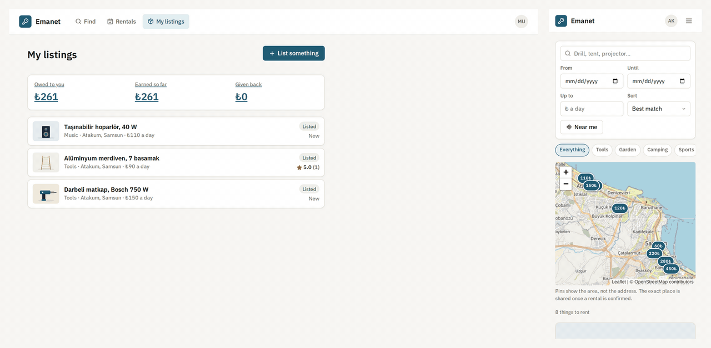
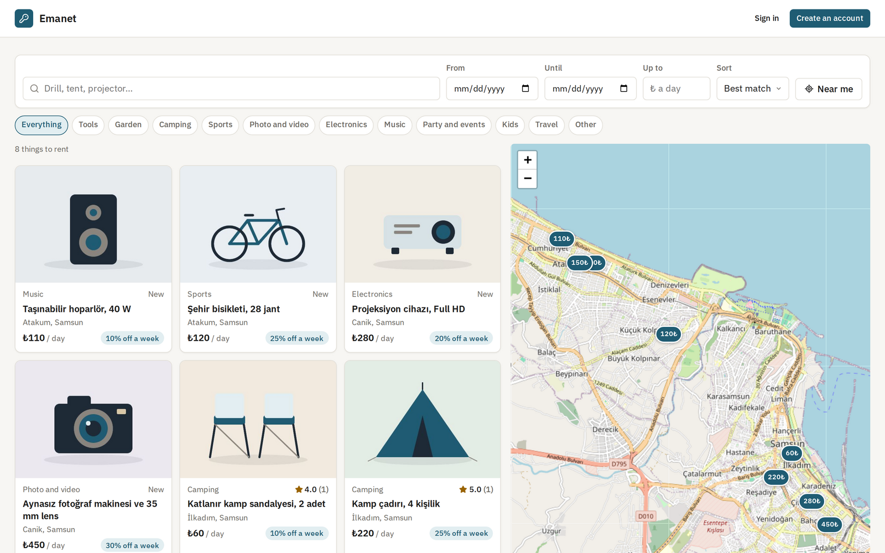
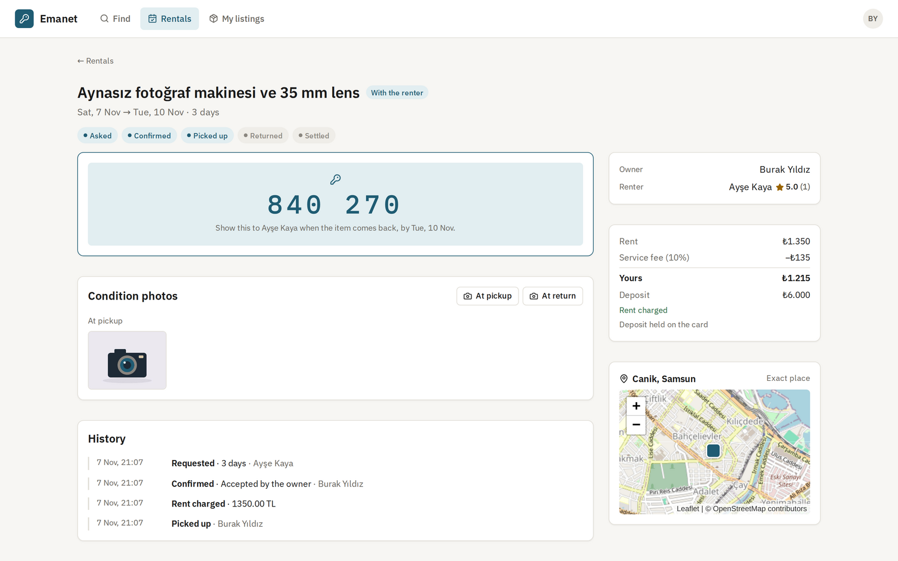
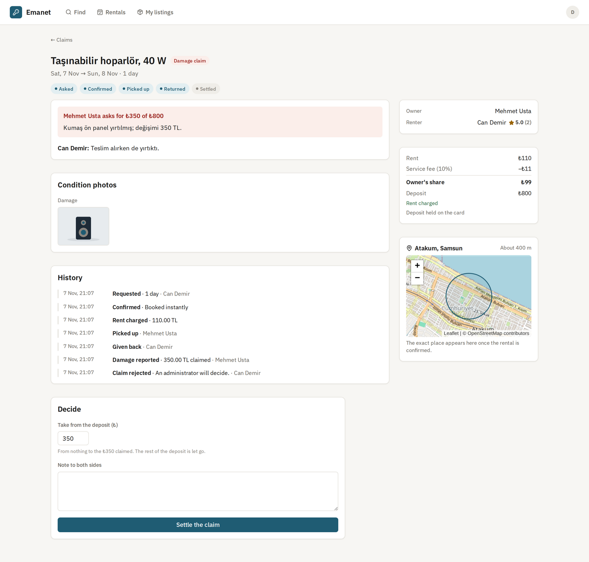
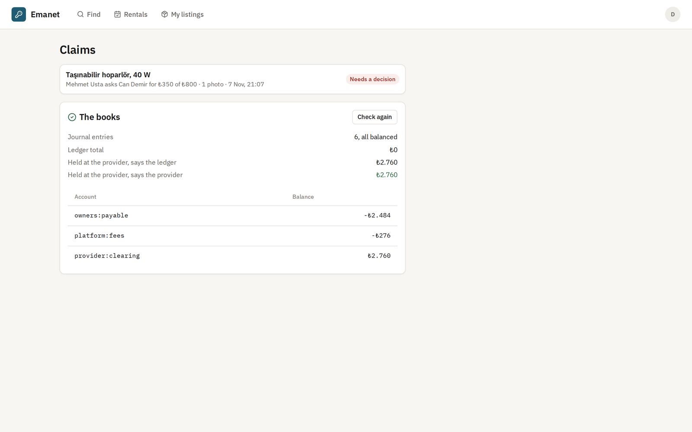
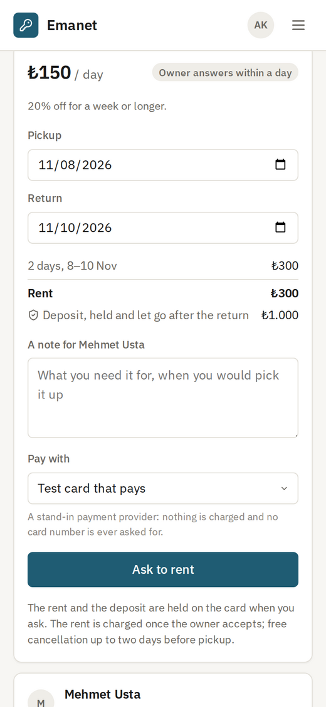
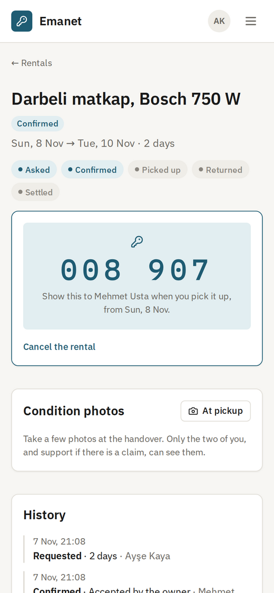
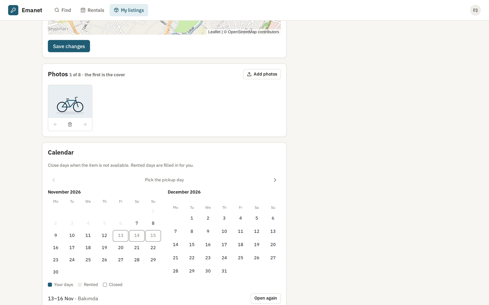
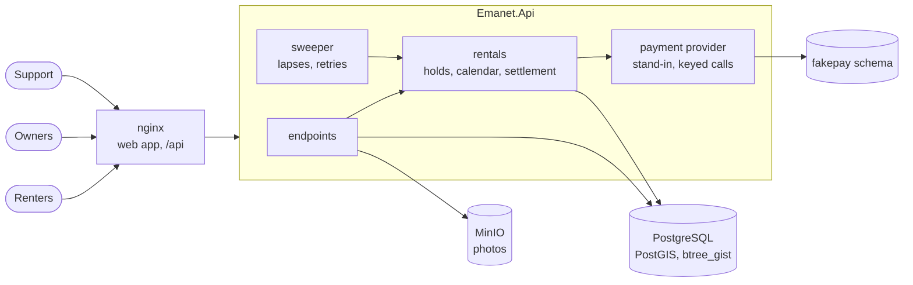
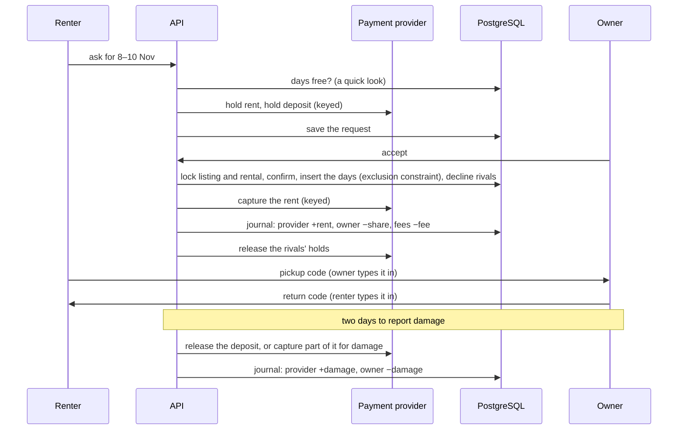

# Emanet

**English** · [Türkçe](README.tr.md)

A marketplace for renting things from people nearby: the drill used twice a year, a tent, a projector for match night. Owners list an item with photos, a price per day, a weekly discount and a deposit. Renters search on a map, pick days on the item's calendar and ask to rent; the rent and the deposit are held on their card, and charged only once the owner accepts. At the handover each side types in a code from the other's screen. When the item comes back, the owner has two days to report damage; otherwise the deposit is let go. A disputed claim goes to support, who decide how much of the deposit to take. Both sides review each other afterwards.

Two people can never get the same days, even when they ask at the same moment: the database refuses overlapping rentals with an exclusion constraint. Every movement of money is posted to a double-entry ledger that the database keeps balanced and append-only, and that is checked against the payment provider.

[](https://github.com/Beratoguzhan620/emanet/actions/workflows/ci.yml)




## Try it

```bash
docker compose up --build
```

This starts PostgreSQL with PostGIS, MinIO for photos, the API and nginx with the web app. Open http://localhost:8080 and look around without an account, or create one. Under *My listings*, list something: pick the place on the map and add a photo. In a private window, create a second account, find the listing, pick days and ask to rent with the test card that pays. Accept the request as the owner, then follow the handover on both screens.

- Support: the account registered as `support@emanet.local` (set by `ADMIN_EMAIL`) sees *Claims* in its menu, with the check of the books.
- Payments use a stand-in provider: `pm_card_ok` pays, `pm_card_declined` is refused, `pm_card_no_funds` has too little money. No card number is ever asked for.
- API reference: http://localhost:8080/scalar

## Features

- **Listings:** title, category, description, price per day, a weekly discount, a deposit, the shortest and longest rental, and instant booking or a request the owner answers. Up to eight photos, turned upright and stripped of their metadata (including where they were taken), stored as a 1600 px JPEG and a thumbnail.
- **Search:** words matched in Turkish and by the start of a word (*çadır* finds *çadırlar*, *sandaly* finds *sandalye*), category, price, distance from where you are, and days the item is free for. Results on a map and in a list.
- **Places kept private:** everyone sees the centre of a cell about 500 m wide, and search measures distance from that cell, so the address cannot be worked out by searching from different points. The exact place appears for the owner, and for the renter once the rental is confirmed.
- **Calendar:** taken days shown to everyone without saying who took them; owners see which days are rented, close days for themselves with a note, and open them again.
- **Requests and instant booking:** asking holds the rent and the deposit on the card. The owner has 24 hours to answer; accepting charges the rent and declines every other request for those days, letting their holds go. A request nobody answers lapses on its own.
- **Cancellation:** owners refund the whole rent; renters get it all back up to 48 hours before pickup, half after that. The deposit hold is always let go.
- **Handover with codes:** the renter's screen shows a pickup code that the owner types in; the owner's screen shows a return code that the renter types in. Neither side can claim a handover happened alone. Five wrong codes replace the code.
- **Condition photos:** either side adds photos at pickup and return, the owner adds damage photos. Only the two of them, and support during a claim, can open them.
- **Damage claims:** within two days of the return, the owner asks for up to the deposit with a description. The renter agrees or asks support; silence for three days counts as agreeing. Support decide anything from nothing to the claimed amount; the rest of the deposit is let go.
- **Reviews:** each side reviews the other once, in the two weeks after a rental that took place. Listings show their stars; owners see a renter's stars on every request.
- **Earnings and the books:** owners see what they are owed, line by line from the ledger. Support see whether every entry balances and whether the ledger matches what the payment provider says it holds.

## Screenshots

| Search on the map | A rental, as its owner |
|---|---|
|  |  |
|  |  |

| Picking days on the phone | The pickup code | The owner's calendar |
|---|---|---|
|  |  |  |

## Measured

`tests/load/load.mjs` runs a booking rush against the full Compose stack on a standard GitHub Actions runner (4 cores), with the load client on the same machine. 300 renters ask, 64 at a time, for 1 to 4 day stretches in the coming two weeks on 20 listings, half of them instant. The owner then accepts every waiting request at once, in random order, while searches run throughout. Afterwards the script checks the calendars, the holds and the books.

| Step | Result |
|---|---|
| The rush | 300 requests in 1.6 s: 195 saved (instant ones confirmed at once), 105 told the days were taken |
| Accepting at once | 148 acceptances in 0.7 s: 51 confirmed, 97 refused because a rival had just won those days |
| Asking to rent (two card holds, and for instant listings the booking itself) | p50 265 ms, p95 936 ms, p99 1.4 s |
| Accepting (charge, calendar, declining rivals) | p50 73 ms, p95 458 ms |
| Reading a rental | p50 24 ms, p95 37 ms |
| What must hold | 98 rentals on the calendars, no day booked twice; every losing request's holds let go; 101 journal entries, all balanced; the ledger equal to the provider's net captures; no server errors |

A second run with 600 renters on 10 listings (much fiercer contention) gave the same outcome: 62 rentals, no overlaps, every hold released, the books balanced, no errors.

What the numbers say:

- Most of the time to ask is the two card holds, each a call to the payment provider; the booking itself is a short transaction.
- Confirmations of one listing take turns behind a row lock. Without it, two acceptances that each decline the other's request wait on each other's rows; with it, the second finds its days taken and stops. The exclusion constraint stays the last word either way.
- Numbers vary between runs on shared runners.

## Tech stack

- ASP.NET Core 10: minimal APIs, a background sweeper, ProblemDetails, OpenAPI with Scalar, JWT bearer, rate limiting
- PostgreSQL 17 with PostGIS and btree_gist: an exclusion constraint over date ranges, deferred constraint triggers, append-only triggers, a stored Turkish full-text vector with a GIN index, geography points and `ST_DWithin`, row locks and `xmin` as a concurrency token; Entity Framework Core 10 with Npgsql and NetTopologySuite
- MinIO through the AWS S3 SDK; SkiaSharp for photos
- React 18, TypeScript and Vite; Leaflet with OpenStreetMap tiles; Lucide icons and IBM Plex; nginx
- xUnit, Testcontainers (PostGIS and MinIO), Vitest, Playwright
- GitHub Actions: warnings as errors, .NET and web tests, pending-migration check, a browser walkthrough against the Compose stack
- Docker / Docker Compose

## Architecture



One rental, from asking to the deposit:



## Design decisions

- **The database says no to double booking.** Every rental and every closed day is a row in `calendar` with a half-open date range. `EXCLUDE USING gist (listing_id WITH =, daterange(start_date, end_date, '[)') WITH &&)` refuses any two rows of a listing that share a day, however the requests interleave. The code checks first, so most people are told before their card is touched; the constraint decides the races. A return day is free for the next pickup.
- **Confirming is one transaction, money comes after.** Accepting confirms the rental, inserts its days and declines every overlapping request together. If the constraint refuses the days, the request is declined instead and its holds released. Money never moves inside these transactions: a slow provider cannot hold locks open, and a rollback cannot leave money moved for something that did not happen.
- **Money moves exactly once.** Settling a rental locks it, calls the provider with a key per step (`booking:{id}:capture-rent`), posts the journal entry under a unique key and marks the step done, all in one transaction. A retry reuses the key and the provider returns its first answer; a second post hits the unique key. If the provider is down, the rental stays confirmed and the sweeper charges it on a later pass.
- **A ledger the database keeps honest.** Each entry is a set of lines that sum to zero (debits positive, credits negative): renter's money at the provider, the owner's share owed to them, the platform's fee. A deferred constraint trigger refuses any entry that does not balance when its transaction commits; other triggers refuse any update or delete, so corrections are new entries. Refunds take back the owner's share and the fee in proportion. Support can check that the provider's net captures equal the ledger's provider account.
- **A stand-in payment provider that behaves like one.** Holds, captures (a partial capture lets the rest go, as card holds do), releases and refunds, each keyed and remembered, in their own schema. The rest of the app sees only `IPaymentProvider`, so a real provider would replace one class.
- **The clock settles what people leave.** A sweeper lets unanswered requests lapse, lets the deposit go when no damage was reported in time, accepts claims the renter did not answer, ends rentals never picked up, and retries any money step that failed. Every step is safe to run twice and on several instances.
- **Places shown by cell.** The public point is the centre of a 0.005° cell (about 500 m), computed when the listing is saved. Search filters, sorts and measures distance with that point only, so nobody can locate an item by searching around it. The exact point is sent only to the owner and a confirmed renter.
- **Turkish search without losing short words.** The Turkish stemmer turns *çadır* into *ça*, which also matches unrelated words. Each listing stores a vector of Turkish stems and plain words, and a query matches either the stems or the starts of the words typed.
- **Photos cleaned on the way in.** The type is read from the first bytes, the image is decoded and re-encoded, turned upright by its EXIF orientation, and saved without any metadata, so a phone photo never carries its GPS position. Condition photos are served only to the two sides and support, with `private` caching; the bucket is never public.

## Commands

| Command | What it does |
|---|---|
| `docker compose up --build` | The whole app on http://localhost:8080 |
| `dotnet test` | .NET unit and integration tests (Docker needed for Testcontainers) |
| `cd web && npm install && npm test` | Web app unit tests |
| `cd web && npm run dev` | The web app with hot reload on http://localhost:5173, against the API on port 5900 |
| `cd tests/e2e && npm install && node emanet.mjs` | The browser walkthrough, against a stack started with `AUTH_ATTEMPTS_PER_MINUTE=1000` |
| `cd tests/e2e && node media.mjs` | Demo listings and rentals, and the README screenshots |
| `node tests/load/load.mjs 300 20` | The load test, against a stack started with `AUTH_ATTEMPTS_PER_MINUTE=100000` (`ADMIN_PASSWORD` if support already has an account) |
| `dotnet ef migrations add <Name> --project src/Emanet.Infrastructure --startup-project src/Emanet.Api --output-dir Persistence/Migrations` | Add a migration |

Configuration for a local run, kept out of the repository:

```bash
dotnet user-secrets --project src/Emanet.Api set "ConnectionStrings:Emanet" "Host=localhost;Database=emanet;Username=…;Password=…"
dotnet user-secrets --project src/Emanet.Api set "Jwt:SigningKey" "<at least 32 characters>"
dotnet user-secrets --project src/Emanet.Api set "Storage:AccessKey" "…"
dotnet user-secrets --project src/Emanet.Api set "Storage:SecretKey" "…"
dotnet user-secrets --project src/Emanet.Api set "Admin:Emails:0" "you@example.com"
```

## Tests

111 tests and a run against the whole stack: 66 .NET unit tests, 40 integration tests that run the real API against PostgreSQL with PostGIS (and MinIO for storage) in Testcontainers, 5 Vitest tests for the web app, and an 11-step Playwright walkthrough with six browsers, all in CI.

- **Listings and search:** prices with the weekly discount to the kuruş, places snapped to their cell, the exact place only for the owner and a confirmed renter, Turkish word forms and word starts, distance from the cell, paging, paused and removed listings, and search by free days.
- **Photos:** all eight EXIF orientations turned upright, GPS removed, small photos not enlarged, PNG turned into JPEG, files that are not images refused, at most eight, and the real store against MinIO.
- **Rentals:** holds on request, charging on accept with the fee split, instant booking, back-to-back rentals allowed and overlaps refused, twenty people booking the same days at once leaving exactly one rental and no one charged for nothing, rivals declined with their holds let go, requests lapsing after a day, refused cards saving nothing, and every cancellation case of the policy.
- **Money:** journal entries balanced and refunds split in proportion, the books reconciled with the provider, the database refusing an unbalanced entry and any change to the ledger, and a provider outage charging later, exactly once.
- **Handover and claims:** codes from the other side's screen, wrong codes counted and the code replaced after five, no pickup before the first day, damage claimed within two days for up to the deposit, a claim accepted taking only that much, a rejected claim decided by support who can see the photos, condition photos private to the two sides, and the clock letting deposits go, accepting silent claims and ending no-shows.
- **Reviews:** once per side, only after a rental that took place, stars adding up on the listing and the renter.
- **Web app (Vitest):** prices like the server's, days in Turkey's time zone, date ranges and initials.
- **Browsers (CI):** an owner listing a drill with a photo; a visitor finding it without seeing the address; a refused card, then a request; accepting; the handover with a wrong code and the right one; private condition photos; the return; a damage claim disputed and decided by support; reviews on both sides; earnings and the books; and two people booking the same days at the same moment.

## Roadmap and known gaps

- A real payment provider (iyzico or Stripe) behind `IPaymentProvider`, with webhooks for captures that finish later.
- Payouts to owners: the ledger has the account, but no transfers are made yet.
- Messages between owner and renter, and notifications through the [notification-service](https://github.com/Beratoguzhan620/notification-service).
- Card holds expire after about a week with real providers; requests made far ahead would need a fresh hold before pickup.
- Rentals end on the calendar day; an hour for pickup and return is agreed between the two sides.
- Overdue returns are not charged extra yet.

## License

[MIT](LICENSE) · Berat Oğuzhan Turğut · [GitHub](https://github.com/Beratoguzhan620)
