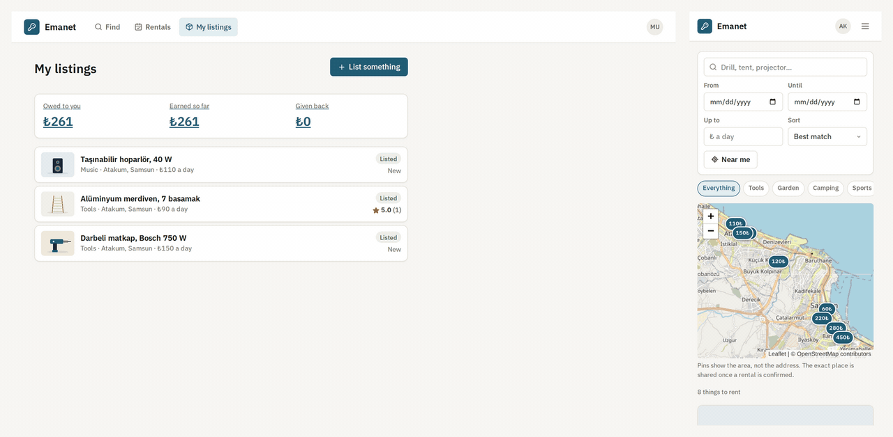
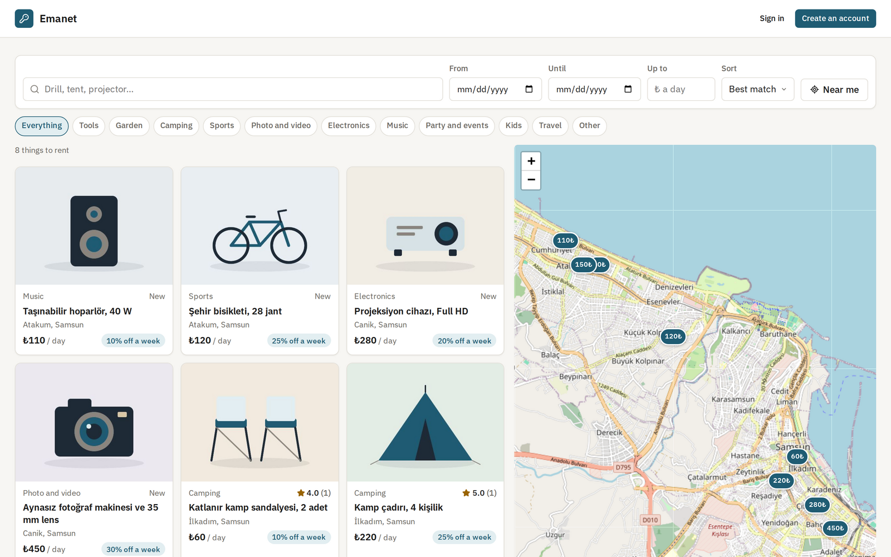
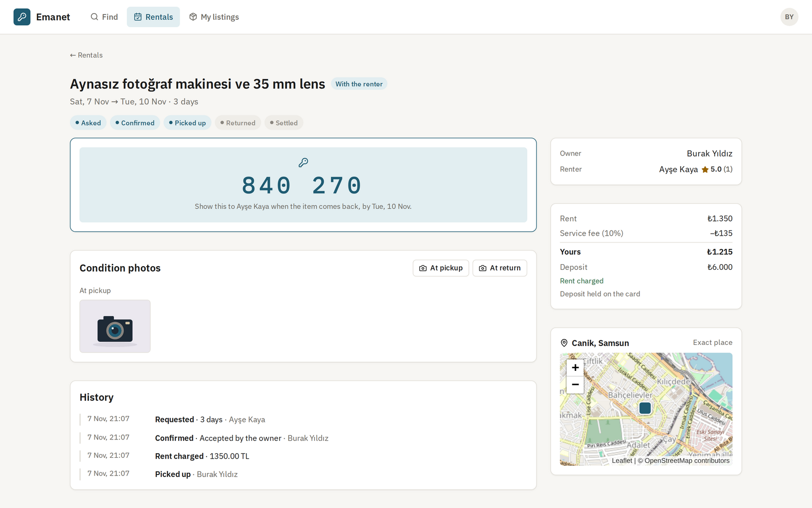
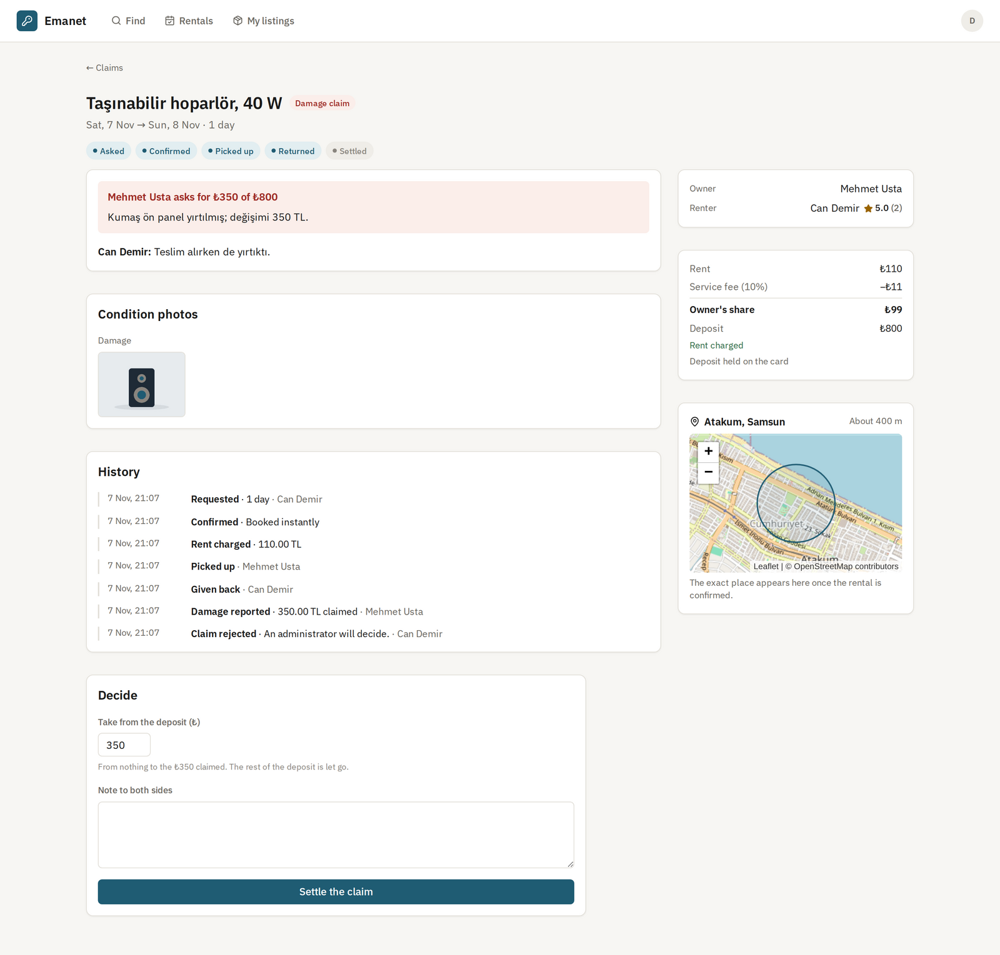
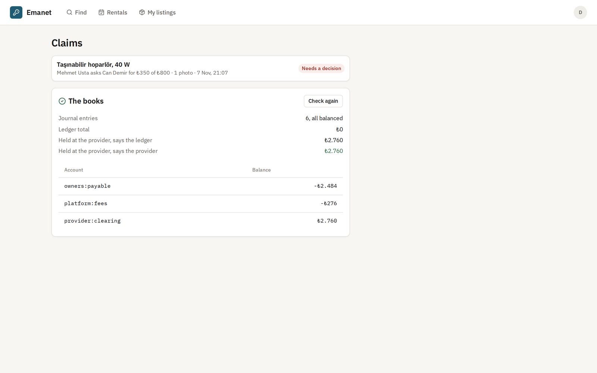
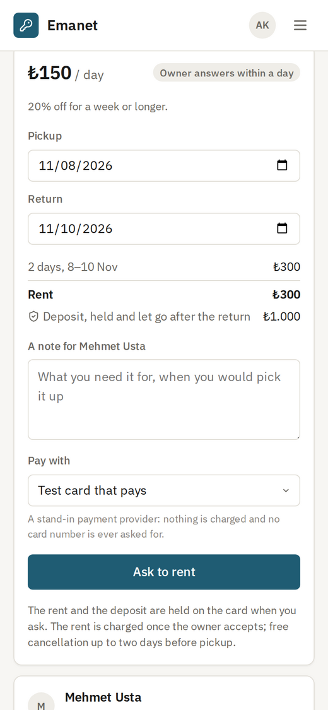
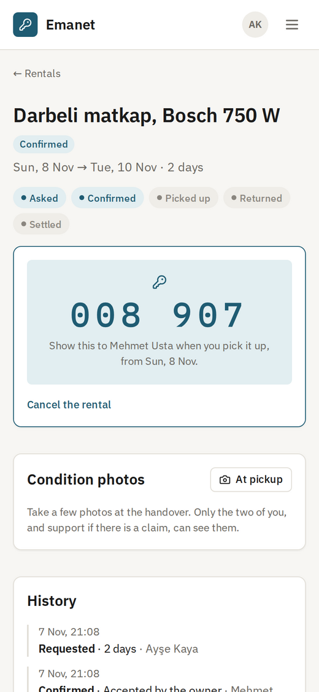
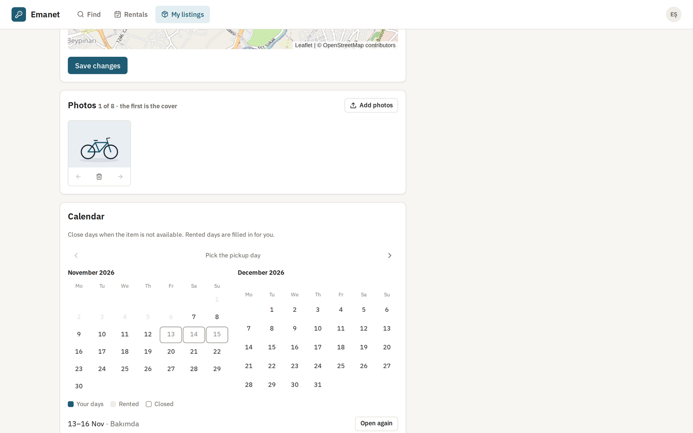
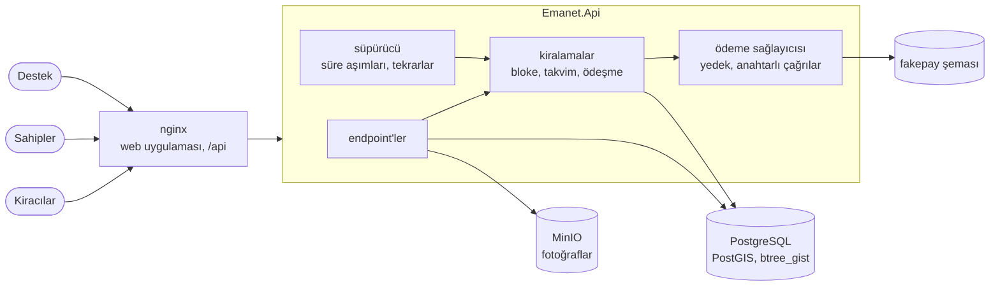
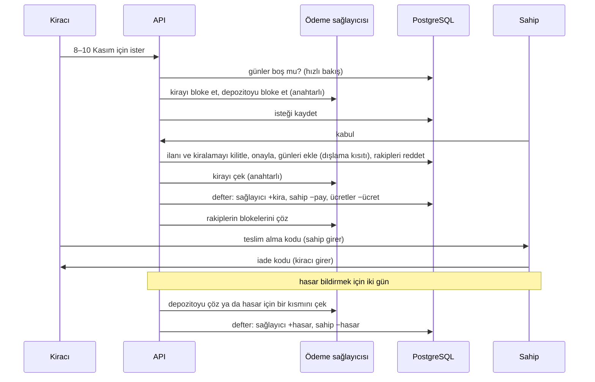

# Emanet

[English](README.md) · **Türkçe**

Yakındaki insanlardan eşya kiralamak için bir pazar yeri: yılda iki kez kullanılan matkap, bir çadır, maç akşamı için bir projeksiyon. Sahipler eşyayı fotoğraflarıyla, günlük fiyatıyla, haftalık indirimiyle ve depozitosuyla ilana koyar. Kiracılar haritada arar, eşyanın takviminde günleri seçer ve kiralamak ister; kira ve depozito kartta bloke edilir, kira ancak sahip kabul edince çekilir. Teslimde iki taraf da karşısındakinin ekranındaki kodu girer. Eşya geri gelince sahibin hasar bildirmek için iki günü vardır; bildirmezse depozito serbest kalır. Anlaşmazlık olan hasar talepleri destek ekibine gider; depozitonun ne kadarının alınacağına onlar karar verir. Sonunda iki taraf birbirini değerlendirir.

İki kişi aynı günleri asla birlikte alamaz, aynı anda isteseler bile: çakışan kiralamaları veritabanı bir dışlama kısıtıyla (exclusion constraint) reddeder. Her para hareketi çift taraflı bir deftere işlenir; defteri veritabanı dengede ve yalnızca eklenebilir tutar, defter de ödeme sağlayıcısıyla karşılaştırılır.

[](https://github.com/Beratoguzhan620/emanet/actions/workflows/ci.yml)




## Deneyin

```bash
docker compose up --build
```

Bu komut PostGIS'li PostgreSQL'i, fotoğraflar için MinIO'yu, API'yi ve web uygulamasıyla nginx'i başlatır. http://localhost:8080 adresini açın; hesap açmadan gezebilir ya da hesap açabilirsiniz. *My listings* altında bir şey ilana koyun: yerini haritada seçin, bir fotoğraf ekleyin. Gizli bir pencerede ikinci bir hesap açın, ilanı bulun, günleri seçin ve ödeme yapan test kartıyla kiralamak isteyin. Sahip olarak isteği kabul edin, sonra teslimi iki ekranda izleyin.

- Destek: `support@emanet.local` adresiyle (`ADMIN_EMAIL` ile değişir) kayıtlı hesabın menüsünde *Claims* ve defter kontrolü görünür.
- Ödemeler bir yedek sağlayıcıyla yapılır: `pm_card_ok` öder, `pm_card_declined` reddedilir, `pm_card_no_funds` yetersiz bakiyedir. Hiçbir zaman kart numarası istenmez.
- API dokümanı: http://localhost:8080/scalar

## Özellikler

- **İlanlar:** başlık, kategori, açıklama, günlük fiyat, haftalık indirim, depozito, en kısa ve en uzun kiralama süresi, anında kiralama ya da sahibin yanıtladığı istek. En çok sekiz fotoğraf; dik çevrilir, meta verileri (çekildiği yer dahil) silinir, 1600 px JPEG ve küçük resim olarak saklanır.
- **Arama:** Türkçe kelime biçimleri ve kelime başları (*çadır* *çadırlar*ı, *sandaly* *sandalye*yi bulur), kategori, fiyat, bulunduğunuz yere uzaklık ve eşyanın boş olduğu günler. Sonuçlar haritada ve listede.
- **Gizli kalan adresler:** herkes yaklaşık 500 m genişliğindeki bir hücrenin merkezini görür; arama da uzaklığı bu hücreden ölçer, yani farklı noktalardan arayarak adres bulunamaz. Tam yer sahibe ve kiralama onaylandıktan sonra kiracıya görünür.
- **Takvim:** dolu günler herkese gösterilir ama kimin aldığı söylenmez; sahip hangi günlerin kiralandığını görür, kendi için not düşerek gün kapatır ve yeniden açar.
- **İstek ve anında kiralama:** istek, kirayı ve depozitoyu kartta bloke eder. Sahibin yanıt için 24 saati vardır; kabul kirayı çeker ve o günler için gelen diğer bütün istekleri reddederek blokelerini çözer. Yanıtlanmayan istek kendiliğinden düşer.
- **İptal:** sahip iptal ederse kiranın tamamı iade edilir; kiracı teslimden 48 saat öncesine kadar tamamını, sonra yarısını geri alır. Depozito blokesi her durumda çözülür.
- **Kodla teslim:** kiracının ekranında sahibin gireceği bir teslim alma kodu, sahibin ekranında kiracının gireceği bir iade kodu görünür. Hiçbir taraf teslimin tek başına yapıldığını iddia edemez. Beş yanlış kodda kod yenilenir.
- **Durum fotoğrafları:** iki taraf da teslim alırken ve iade ederken, sahip de hasar için fotoğraf ekler. Bunları yalnızca iki taraf ve bir talep sırasında destek açabilir.
- **Hasar talepleri:** sahip, iadeden sonraki iki gün içinde açıklamayla birlikte depozitoya kadar bir tutar ister. Kiracı kabul eder ya da desteğe gönderir; üç gün sessiz kalmak kabul sayılır. Destek sıfırdan talep edilen tutara kadar karar verir; depozitonun kalanı serbest kalır.
- **Değerlendirmeler:** iki taraf da gerçekleşmiş bir kiralamadan sonraki iki hafta içinde birbirini bir kez değerlendirir. İlanlar yıldızlarını gösterir; sahipler her istekte kiracının yıldızlarını görür.
- **Kazançlar ve defter:** sahipler alacaklarını defterden satır satır görür. Destek her kaydın dengede olup olmadığını ve defterin, ödeme sağlayıcısının elinde tuttuğunu söylediği tutarla eşleşip eşleşmediğini görür.

## Ekran görüntüleri

| Haritada arama | Sahibinin gözünden bir kiralama |
|---|---|
|  |  |
|  |  |

| Telefonda gün seçmek | Teslim alma kodu | Sahibin takvimi |
|---|---|---|
|  |  |  |

## Ölçümler

`tests/load/load.mjs`, standart bir GitHub Actions makinesinde (4 çekirdek), yük istemcisi de aynı makinedeyken, Compose yığınının tamamına karşı bir kiralama akını çalıştırır. 300 kiracı, aynı anda 64'er kişi, önümüzdeki iki hafta içinde 1 ile 4 günlük aralıklar için, yarısı anında kiralanan 20 ilan ister. Ardından sahip bekleyen bütün istekleri aynı anda ve rastgele sırayla kabul eder; bu sırada aramalar sürer. Sonunda betik takvimleri, blokeleri ve defteri kontrol eder.

| Adım | Sonuç |
|---|---|
| Akın | 1,6 sn'de 300 istek: 195'i kaydedildi (anında olanlar hemen onaylandı), 105'ine günlerin dolu olduğu söylendi |
| Aynı anda kabul | 0,7 sn'de 148 kabul: 51'i onaylandı, 97'si o günleri bir rakip az önce kazandığı için reddedildi |
| Kiralamak istemek (iki kart blokesi, anında ilanlarda kiralamanın kendisi) | p50 265 ms, p95 936 ms, p99 1,4 sn |
| Kabul (kira çekimi, takvim, rakiplerin reddi) | p50 73 ms, p95 458 ms |
| Bir kiralamayı okumak | p50 24 ms, p95 37 ms |
| Bozulmaması gerekenler | takvimlerde 98 kiralama, hiçbir gün iki kez yok; kaybeden her isteğin blokesi çözüldü; 101 defter kaydı, hepsi dengede; defter, sağlayıcının net çekimine eşit; sunucu hatası yok |

10 ilan için 600 kiracıyla (çok daha sert bir rekabet) yapılan ikinci çalıştırma aynı sonucu verdi: 62 kiralama, çakışma yok, bütün blokeler çözüldü, defter dengede, hata yok.

Sayıların söyledikleri:

- İstemenin süresinin çoğu, her biri ödeme sağlayıcısına bir çağrı olan iki kart blokesidir; kiralamanın kendisi kısa bir transaction'dır.
- Bir ilanın onayları bir satır kilidinin arkasında sırayla yürür. Kilit olmasa, birbirinin isteğini reddeden iki kabul birbirinin satırını bekler; kilitle ikincisi günlerinin dolduğunu görüp durur. Son sözü her durumda dışlama kısıtı söyler.
- Sayılar, paylaşılan makinelerde çalıştırmadan çalıştırmaya değişir.

## Teknolojiler

- ASP.NET Core 10: minimal API'ler, arka planda çalışan bir süpürücü, ProblemDetails, Scalar ile OpenAPI, JWT bearer, hız sınırlama
- btree_gist ve PostGIS'li PostgreSQL 17: tarih aralıkları üzerinde dışlama kısıtı, ertelenmiş kısıt tetikleyicileri, yalnızca eklemeye izin veren tetikleyiciler, GIN indeksli saklanan Türkçe tam metin vektörü, coğrafi noktalar ve `ST_DWithin`, satır kilitleri ve eşzamanlılık belirteci olarak `xmin`; Npgsql ve NetTopologySuite ile Entity Framework Core 10
- AWS S3 SDK üzerinden MinIO; fotoğraflar için SkiaSharp
- React 18, TypeScript ve Vite; OpenStreetMap karolarıyla Leaflet; Lucide ikonları ve IBM Plex; nginx
- xUnit, Testcontainers (PostGIS ve MinIO), Vitest, Playwright
- GitHub Actions: uyarılar hata sayılır, .NET ve web testleri, eksik migration kontrolü, Compose yığınına karşı tarayıcı senaryosu
- Docker / Docker Compose

## Mimari



İstekten depozitoya bir kiralama:



## Tasarım kararları

- **Çifte kiralamaya veritabanı hayır der.** Her kiralama ve her kapatılmış gün, `calendar` tablosunda yarı açık bir tarih aralığıyla bir satırdır. `EXCLUDE USING gist (listing_id WITH =, daterange(start_date, end_date, '[)') WITH &&)`, istekler nasıl iç içe geçerse geçsin, bir ilanın aynı günü paylaşan iki satırını reddeder. Kod önce kendisi bakar, böylece çoğu kişiye kartına dokunulmadan söylenir; yarışları kısıt karara bağlar. İade günü bir sonraki teslim için boştur.
- **Onay tek transaction, para sonra.** Kabul; kiralamayı onaylamayı, günlerini eklemeyi ve çakışan bütün istekleri reddetmeyi birlikte yapar. Kısıt günleri reddederse istek reddedilir ve blokeleri çözülür. Para bu transaction'ların içinde hiç hareket etmez: yavaş bir sağlayıcı kilitleri açık tutamaz, bir geri alma da olmayan bir şey için para hareket etmiş halde bırakamaz.
- **Para tam bir kez hareket eder.** Bir kiralamanın ödeşmesi onu kilitler, sağlayıcıyı her adım için bir anahtarla (`booking:{id}:capture-rent`) çağırır, defter kaydını benzersiz bir anahtarla işler ve adımı tamamlandı olarak işaretler; hepsi tek transaction'da. Tekrar aynı anahtarı kullanır, sağlayıcı ilk yanıtını döner; ikinci kayıt benzersiz anahtara takılır. Sağlayıcı çökmüşse kiralama onaylı kalır, süpürücü kirayı sonraki bir turda çeker.
- **Veritabanının dürüst tuttuğu bir defter.** Her kayıt toplamı sıfır olan satırlardan oluşur (borç artı, alacak eksi): kiracının sağlayıcıdaki parası, sahibe borçlu olunan pay, platformun ücreti. Ertelenmiş bir kısıt tetikleyicisi, transaction'ı commit edilirken dengede olmayan her kaydı reddeder; başka tetikleyiciler her güncellemeyi ve silmeyi reddeder, düzeltmeler yeni kayıttır. İadeler sahibin payından ve ücretten orantılı alınır. Destek, sağlayıcının net çekiminin defterdeki sağlayıcı hesabına eşit olduğunu kontrol edebilir.
- **Gerçeği gibi davranan bir yedek ödeme sağlayıcısı.** Bloke, çekim (kısmi çekim, kart blokelerinde olduğu gibi kalanı serbest bırakır), çözme ve iade; her biri anahtarlı ve hatırlanır, kendi şemasında. Uygulamanın geri kalanı yalnızca `IPaymentProvider`'ı görür; gerçek bir sağlayıcı tek bir sınıfın yerini alır.
- **İnsanların bıraktığını saat tamamlar.** Süpürücü yanıtlanmayan istekleri düşürür, zamanında hasar bildirilmezse depozitoyu serbest bırakır, kiracının yanıtlamadığı talepleri kabul eder, hiç teslim alınmamış kiralamaları bitirir ve başarısız olan her para adımını yeniden dener. Her adım iki kez ve birden fazla sunucuda çalışmaya uygundur.
- **Yerler hücreyle gösterilir.** Herkese açık nokta, ilan kaydedilirken hesaplanan 0,005°'lik (yaklaşık 500 m) bir hücrenin merkezidir. Arama yalnızca bu noktayla süzer, sıralar ve uzaklık ölçer; kimse etrafında arama yaparak bir eşyanın yerini bulamaz. Tam nokta yalnızca sahibe ve onaylı kiracıya gönderilir.
- **Kısa kelimeleri kaybetmeyen Türkçe arama.** Türkçe kök bulucu *çadır*ı *ça*ya çevirir; bu da alakasız kelimeleri eşleştirir. Her ilan Türkçe köklerden ve düz kelimelerden oluşan bir vektör saklar; sorgu ya köklerle ya da yazılan kelimelerin başlarıyla eşleşir.
- **Fotoğraflar girerken temizlenir.** Tür ilk baytlardan okunur, görüntü çözülüp yeniden kodlanır, EXIF yönüne göre dik çevrilir ve hiçbir meta veri olmadan kaydedilir; telefon fotoğrafı GPS konumunu asla taşımaz. Durum fotoğrafları yalnızca iki tarafa ve desteğe, `private` önbellekle sunulur; bucket hiçbir zaman herkese açık değildir.

## Komutlar

| Komut | Ne yapar |
|---|---|
| `docker compose up --build` | Uygulamanın tamamı http://localhost:8080 adresinde |
| `dotnet test` | .NET birim ve entegrasyon testleri (Testcontainers için Docker gerekir) |
| `cd web && npm install && npm test` | Web uygulaması birim testleri |
| `cd web && npm run dev` | 5900 portundaki API'ye karşı, anında yenilenen web uygulaması http://localhost:5173 adresinde |
| `cd tests/e2e && npm install && node emanet.mjs` | `AUTH_ATTEMPTS_PER_MINUTE=1000` ile başlatılmış yığına karşı tarayıcı senaryosu |
| `cd tests/e2e && node media.mjs` | Örnek ilanlar ve kiralamalar, README ekran görüntüleri |
| `node tests/load/load.mjs 300 20` | `AUTH_ATTEMPTS_PER_MINUTE=100000` ile başlatılmış yığına karşı yük testi (destek hesabı zaten varsa `ADMIN_PASSWORD`) |
| `dotnet ef migrations add <Ad> --project src/Emanet.Infrastructure --startup-project src/Emanet.Api --output-dir Persistence/Migrations` | Migration ekler |

Yerel çalıştırma ayarları, depoda tutulmaz:

```bash
dotnet user-secrets --project src/Emanet.Api set "ConnectionStrings:Emanet" "Host=localhost;Database=emanet;Username=…;Password=…"
dotnet user-secrets --project src/Emanet.Api set "Jwt:SigningKey" "<en az 32 karakter>"
dotnet user-secrets --project src/Emanet.Api set "Storage:AccessKey" "…"
dotnet user-secrets --project src/Emanet.Api set "Storage:SecretKey" "…"
dotnet user-secrets --project src/Emanet.Api set "Admin:Emails:0" "siz@example.com"
```

## Testler

111 test ve yığının tamamına karşı bir çalıştırma: 66 .NET birim testi, gerçek API'yi Testcontainers'taki PostGIS'li PostgreSQL'e (depolama için MinIO'ya) karşı çalıştıran 40 entegrasyon testi, web uygulaması için 5 Vitest testi ve altı tarayıcıyla 11 adımlı bir Playwright senaryosu; hepsi CI'da.

- **İlanlar ve arama:** haftalık indirimli fiyatlar kuruşuna kadar, hücreye oturtulan yerler, tam yerin yalnızca sahibe ve onaylı kiracıya gösterilmesi, Türkçe kelime biçimleri ve kelime başları, hücreden uzaklık, sayfalama, duraklatılmış ve kaldırılmış ilanlar, boş günlere göre arama.
- **Fotoğraflar:** sekiz EXIF yönünün hepsi dik çevrilir, GPS silinir, küçük fotoğraflar büyütülmez, PNG JPEG'e döner, görüntü olmayan dosyalar reddedilir, en çok sekiz tane, gerçek depolama MinIO'ya karşı.
- **Kiralamalar:** istekte bloke, kabulde ücret ayrımıyla çekim, anında kiralama, art arda kiralamalara izin verilip çakışmaların reddedilmesi, aynı günleri aynı anda kiralayan yirmi kişiden tam bir kiralama kalması ve kimsenin boşuna ödememesi, blokeleri çözülerek reddedilen rakipler, bir gün sonra düşen istekler, hiçbir şey kaydetmeyen reddedilmiş kartlar ve iptal kuralının her durumu.
- **Para:** dengede defter kayıtları ve orantılı bölünen iadeler, sağlayıcıyla mutabık defter, dengesiz kaydı ve defterdeki her değişikliği reddeden veritabanı, sağlayıcı kesintisinde kiranın sonradan, tam bir kez çekilmesi.
- **Teslim ve talepler:** karşı tarafın ekranından kodlar, sayılan yanlış kodlar ve beşincide yenilenen kod, ilk günden önce teslim alınamaması, iki gün içinde depozitoya kadar hasar talebi, kabul edilen talebin yalnızca o kadar alması, fotoğrafları görebilen desteğin karar verdiği reddedilmiş talep, iki tarafa özel durum fotoğrafları, saatin depozitoyu serbest bırakması, sessiz talepleri kabul etmesi ve gelmeyenleri bitirmesi.
- **Değerlendirmeler:** taraf başına bir kez, yalnızca gerçekleşmiş bir kiralamadan sonra; yıldızlar ilanda ve kiracıda toplanır.
- **Web uygulaması (Vitest):** sunucununkiyle aynı fiyatlar, Türkiye saatiyle günler, tarih aralıkları ve baş harfler.
- **Tarayıcılar (CI):** fotoğrafla matkap ilanı veren bir sahip; adresi görmeden onu bulan bir ziyaretçi; reddedilen bir kart, ardından bir istek; kabul; yanlış ve doğru kodla teslim; özel durum fotoğrafları; iade; itiraz edilip destekçe karara bağlanan hasar talebi; iki taraflı değerlendirmeler; kazançlar ve defter; aynı günleri aynı anda kiralamaya çalışan iki kişi.

## Yol haritası ve bilinen eksikler

- `IPaymentProvider` arkasında gerçek bir ödeme sağlayıcısı (iyzico ya da Stripe), sonradan tamamlanan çekimler için webhook'larla.
- Sahiplere ödeme: defterde hesap var ama henüz transfer yapılmıyor.
- Sahip ile kiracı arasında mesajlaşma ve [notification-service](https://github.com/Beratoguzhan620/notification-service) üzerinden bildirimler.
- Gerçek sağlayıcılarda kart blokeleri yaklaşık bir haftada düşer; çok önceden yapılan istekler için teslimden önce yeniden bloke gerekir.
- Kiralamalar takvim gününde biter; teslim ve iade saati iki taraf arasında kararlaştırılır.
- Geç iadeler için henüz ek ücret alınmıyor.

## Lisans

[MIT](LICENSE) · Berat Oğuzhan Turğut · [GitHub](https://github.com/Beratoguzhan620)
